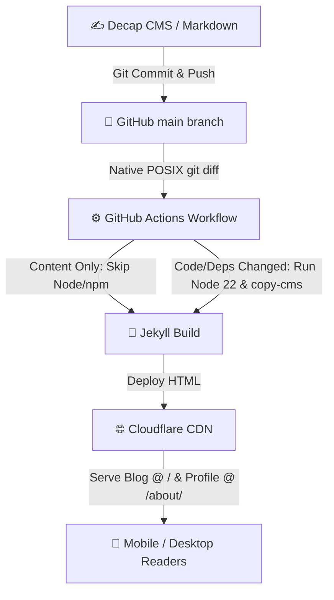

# 🚀 Decap CMS + GitHub Pages + Cloudflare Static Blog Template

[](https://pages.github.com/)
[](https://jekyllrb.com/)
[](https://workers.cloudflare.com/)
[](https://decapcms.org/)

A zero-cost, zero-maintenance, high-performance static blog and profile site template. 

Features **Ghost-like visual WYSIWYG editing** via Decap CMS, **GitHub 2FA authentication**, **native zero-trust CI path filtering** (sub-18s builds), **TTS text-to-speech article reader**, **Mermaid.js diagram rendering**, and **fluid mobile-first design**.

---

## 🚀 Quick Setup Guide

### 1. Click "Use this template"
Click the green **"Use this template"** -> **"Create a new repository"** button at the top of this repository.

Name your repository `<your-github-username>.github.io` (for a root GitHub Pages site) or any repo name.

---

### 2. Configure Site Settings
Replace placeholders in these 3 files in your new repository:

1. **`_config.yml`**:
   - Set `url: "https://<your-domain>"`
   - Set `title: "<your-site-name>"`
   - Set `github_username: "<your-github-username>"`

2. **`admin/config.yml`**:
   - Set `repo: "<your-github-username>/<your-repo-name>"`
   - Set `base_url: "https://<your-worker-name>.<your-subdomain>.workers.dev"`

3. **`CNAME`**:
   - Set `<your-domain>` (or delete this file if using `<username>.github.io` without a custom domain).

---

### 3. Deploy OAuth Worker (Cloudflare)
Static GitHub Pages sites cannot store secrets safely. Deploy the lightweight serverless OAuth worker (`cloudflare-oauth-worker/`) to your Cloudflare account:

1. **Create GitHub OAuth App**:
   - Go to **GitHub Settings** -> **Developer Settings** -> **OAuth Apps** -> **New OAuth App**.
   - **Homepage URL**: `https://<your-domain>`
   - **Authorization callback URL**: `https://<your-worker-name>.<your-subdomain>.workers.dev/callback`
   - Copy **Client ID** and generate a **Client Secret**.

2. **Deploy Worker**:
   ```bash
   cd cloudflare-oauth-worker
   
   # Add your GitHub Client ID to wrangler.toml
   # Set your GitHub Client Secret as an encrypted environment secret
   npx wrangler secret put OAUTH_CLIENT_SECRET
   
   # Deploy
   npx wrangler deploy
   ```

---

### 4. Enable GitHub Pages Deployment
1. Go to your GitHub repository **Settings** -> **Pages**.
2. Set **Source** to **GitHub Actions**.
3. Under **Custom domain**, enter `<your-domain>` and enable **Enforce HTTPS**.

---

## 🛠️ Architecture & Features



- **🎧 Listen to Article**: Native browser SpeechSynthesis TTS audio reader + optional custom MP3 podcast track support.
- **🎨 Fluid Responsive UI**: Smart auto-hiding header, hamburger drawer, reading progress bar, dark/light theme switcher.
- **📊 Mermaid.js Diagrams**: Automatic client-side SVG rendering for ```mermaid code blocks in Markdown.
- **🔒 Zero-Trust CI**: Uses 100% native `git diff` execution to skip Node/npm on markdown edits, producing fast sub-18s builds with zero 3rd-party action dependencies.
- **⚡ Tooling**: Environment runtimes managed locally via [`mise`](https://mise.jdx.dev/) (`mise.toml`).

---

## 📂 Project Structure

```text
├── .github/workflows/deploy.yml # Zero-trust native git diff deploy workflow
├── _layouts/
│   ├── default.html             # Fluid responsive layout shell & header
│   └── post.html                # Medium-style post layout with TTS reader & progress bar
├── _posts/                      # Markdown blog posts
├── about/index.html             # Profile & career page (/about/)
├── admin/                       # Decap CMS visual editor & live preview styling
├── cloudflare-oauth-worker/     # Serverless OAuth worker proxy
├── index.html                   # Blog listing & topic filter homepage
├── mise.toml                    # Node 22 environment pin
└── CNAME                        # Custom domain binding
```

---

## 💻 Local Development

```bash
git clone https://github.com/<your-github-username>/<your-repo-name>.git
cd <your-repo-name>

# Install dependencies (mise automatically uses Node 22)
npm install

# Bundle Decap CMS assets
npm run copy-cms

# Local offline Decap CMS proxy server
npx decap-server
```

---

## 📄 License

Released under the [MIT License](LICENSE).
